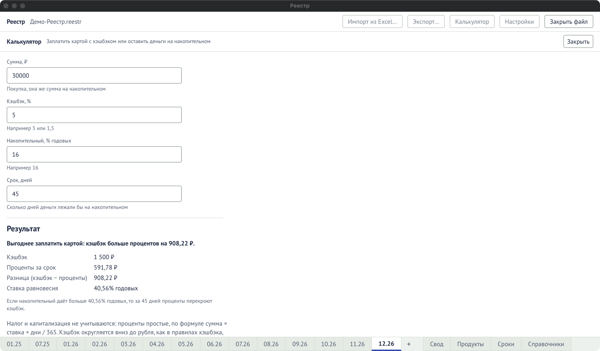

Бывает так: покупку можно оплатить картой с кэшбэком, а можно оставить эти деньги ещё на какое-то
время на накопительном счёте и получать проценты. Кнопка **«Калькулятор»** в шапке считает, что
из двух приносит больше.

Калькулятор ничего не записывает в файл: введённые числа нигде не сохраняются и исчезают, когда
вы закрываете его кнопкой «Закрыть».

## Как посчитать

1. Нажмите **«Калькулятор»** в шапке.
2. В поле **«Сумма, ₽»** введите сумму покупки, например `100 000`.
3. В поле **«Кэшбэк, %»** введите процент кэшбэка карты, например `5`.
4. В поле **«Накопительный, % годовых»** введите ставку счёта, например `16`.
5. В поле **«Срок, дней»** введите, сколько дней деньги лежали бы на счёте, например `30`.

Результат появляется сам, как только заполнены все четыре поля, и пересчитывается при каждой
правке. Для примера выше: кэшбэк — 5 000 ₽, проценты за 30 дней — 1 315,07 ₽, «Выгоднее заплатить
картой», ставка равновесия — 60,83% годовых.

## Как читать результат

- **«Кэшбэк»** — сколько вернёт карта. Округляется вниз до рубля, как в
  [правилах кэшбэка](/guide/cashback-rules/).
- **«Проценты за срок»** — сколько принесёт накопительный за указанные дни. Проценты простые:
  сумма × ставка × дни ÷ 365, округление до копейки.
- **«Разница (кэшбэк − проценты)»** — положительная, если выгоднее карта, отрицательная, если
  накопительный.
- **«Ставка равновесия»** — ставка накопительного, при которой проценты за срок ровно равны
  кэшбэку. Если счёт даёт больше, выгоднее он; если меньше — карта. Для короткого срока она может
  оказаться больше 100% годовых: это нормально, значит, карта почти всегда выгоднее. При сроке
  0 дней или нулевой сумме ставка равновесия «не определена».

Над цифрами одной фразой сказано, что выгоднее и на сколько.

## Что не учитывается

**Налог и капитализация не учитываются.** Проценты по счёту считаются простыми, без
начисления процентов на проценты и без налога на доход по вкладам. Результат — оценка для
сравнения, а не выписка банка.

Подробнее обо всех полях и ограничениях — в [справочнике «Калькулятор»](/reference/calculator/).
Если программа отказалась считать, см. [«Сообщения программы»](/help/messages/).
