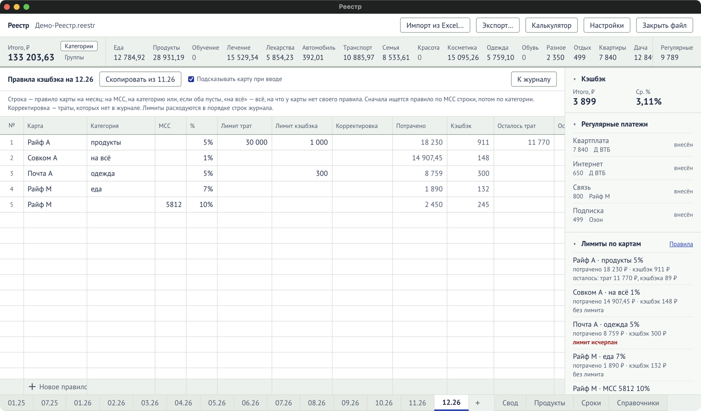

Банки дают разный кэшбэк на разные категории и меняют условия каждый месяц. В Реестре это
записывается **правилами**: одно правило — одна карта, одна категория или один MCC, один месяц.

## Открыть правила

На листе месяца в блоке **«Лимиты по картам»** нажмите **«Правила»**. Откроется таблица
«Правила кэшбэка на 11.26». Вернуться к журналу — кнопка **«К журналу»**.

## Задать правило

В строке **«Новое правило»** введите:

1. **Карта** — с неё правило начинается;
2. **Категория** — назначение, на которое действует процент. Пусто или «на всё» — правило на
   всё, на что у карты нет своего правила;
3. **MCC** — вместо категории, если банк считает кэшбэк по коду продавца: 4 цифры, например
   `5812`. У правила либо MCC, либо категория: категорию оставьте пустой;
4. **%** — процент кэшбэка;
5. **Лимит трат** и **Лимит кэшбэка** — если у банка есть ограничения. Пусто — без лимита;
6. **Корректировка** — траты по этому правилу, которых нет в журнале (например, покупки другого
   члена семьи по той же акции).

Колонки «Потрачено», «Кэшбэк», «Осталось трат», «Осталось кэшбэка» программа считает сама.
Подробно о каждой колонке — в справочнике [«Правила кэшбэка»](/reference/rules/).

У одной карты в одном месяце может быть только одно правило на категорию и одно на MCC.

## Скопировать правила из прошлого месяца

Кнопка **«Скопировать из 10.26»** переносит правила прошлого месяца — как раньше при создании
нового листа. Потом поправьте то, что изменилось.

## Как считается кэшбэк

- Строка журнала попадает под правило своей карты для своего **MCC**; если такого нет — для
  своего **назначения**; если и такого нет — под правило карты **«на всё»**.
- Лимиты у каждого правила свои: строка с MCC расходует лимит правила по MCC, а не правила её
  назначения.
- Кэшбэк = сумма × процент, округлённый так, как считает банк этой карты (настройка
  «Округление кэшбэка» в справочнике [«Карты и счета»](/reference/dictionaries/#карты-и-счета)).
- **Лимиты расходуются в порядке строк журнала.** Когда лимит кончился, следующие строки
  получают меньше кэшбэка или ноль.
- Кэшбэк, **введённый вручную**, программа не трогает, но он тоже расходует лимит.

## Если правило поменялось задним числом

Если изменение правила меняет кэшбэк уже введённых строк, программа спросит:

- **«Пересчитать»** — кэшбэк строк посчитается по новым правилам;
- **«Оставить как есть»** — строки сохранят нынешний кэшбэк.

`Ctrl+Z` отменяет и правку правила, и пересчёт.

## Подсказка карты

Галочка **«Подсказывать карту при вводе»** вверху экрана правил включает список «какой картой
платить» в колонке «Карта» журнала. Она учитывает MCC и назначение строки, если они уже введены.
Галочка хранится в файле.
