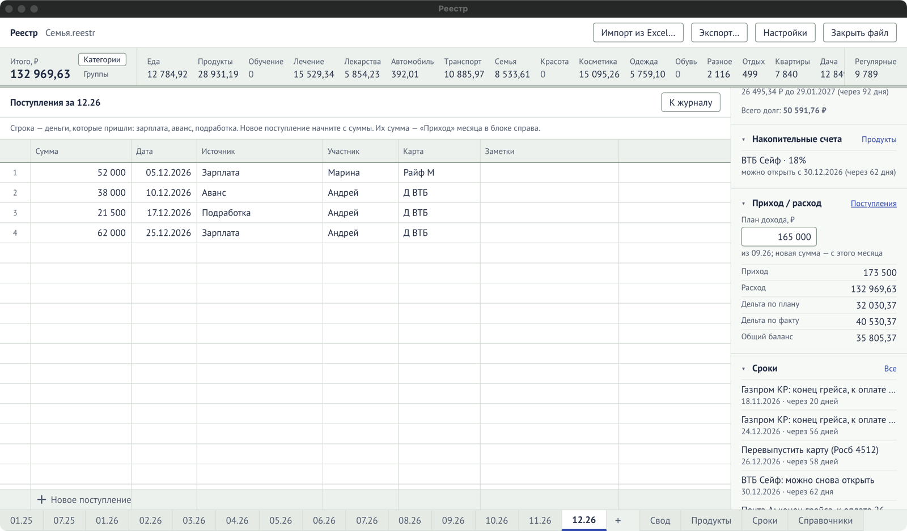
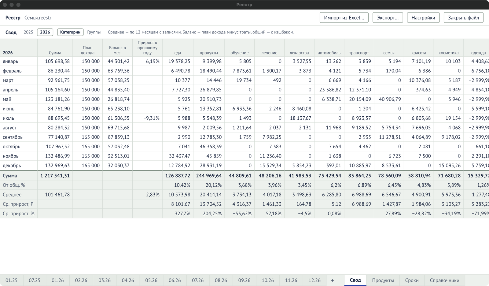

## План дохода

**План дохода** — сколько семья рассчитывает получить в месяц (раньше — «Оклад» в Excel). Он
вводится в блоке **«Приход / расход»** справа на листе месяца, в поле «План дохода, ₽»:
наберите сумму и нажмите `Enter`.

План **переносится на следующие месяцы**, пока вы его не поменяете. Под полем написано, откуда
он взят: «из 09.26; новая сумма — с этого месяца». Новая сумма действует с этого месяца и
дальше; прошлые месяцы не меняются.

## Поступления

Поступления — деньги, которые реально пришли: зарплата, аванс, подработка. Нажмите
**«Поступления»** в блоке «Приход / расход», откроется таблица «Поступления за 11.26». В
строке «Новое поступление» начните с **суммы**, затем дата, источник, участник, карта,
заметки. Вернуться — **«К журналу»**.

## Баланс месяца

В блоке «Приход / расход»:

| Показатель      | Как считается                                |
| --------------- | -------------------------------------------- |
| Приход          | сумма поступлений месяца                     |
| Расход          | сумма трат журнала                           |
| Дельта по плану | план дохода − расход                         |
| Дельта по факту | приход − расход                              |
| Общий баланс    | план дохода + кэшбэк − расход, как в «Своде» |

Отрицательное — красным.

## «Свод»

**«Свод»** (вкладка внизу) — год по месяцам, как лист «Свод» в Excel. Ничего вводить не нужно:
всё считается из журнала, плана дохода и поступлений.

- Вверху — вкладки **лет** (только годы, где есть записи) и переключатель колонок
  **«Категории / Группы»** (общий с полосой итогов на листе месяца).
- Строки — месяцы. Месяцы без записей бледные и показывают только план.
- Колонки: сумма трат, план дохода, баланс, прирост к прошлому году, траты по назначениям,
  регулярные, кэшбэк, общий баланс, общий процент кэшбэка.
- Внизу — сумма за год, доля каждой колонки, среднее, и средний прирост к прошлому году.

Что значит каждая колонка и строка — в справочнике [«Свод»](/reference/summary/).
