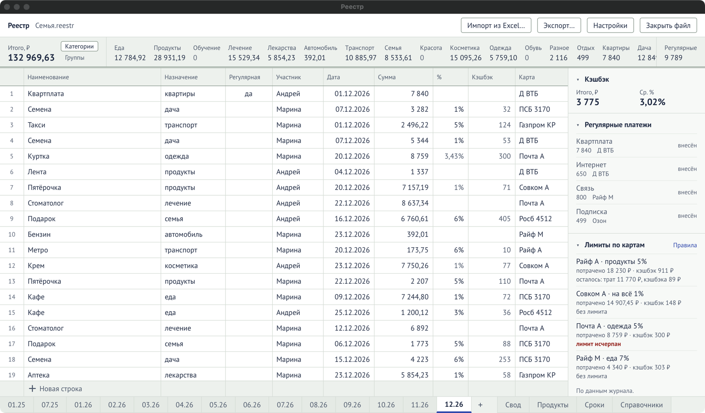

Лист месяца — главный экран. Он устроен как лист в Excel:

- **сверху** — полоса итогов месяца по назначениям;
- **слева** — журнал трат;
- **справа** — блоки: кэшбэк, регулярные платежи, лимиты по картам, кредитки, накопительные
  счета, приход и расход, сроки;
- **внизу** — вкладки месяцев (`07.26`, `08.26`…) и листы «Свод», «Продукты», «Сроки»,
  «Справочники».

Колонки журнала те же, что в Excel:

`№ | Наименование | Назначение | Регулярная | Участник | Дата | Сумма | % | Кэшбэк | Карта`.
Что значит каждая — в справочнике [«Колонки журнала»](/reference/columns/).

## Добавить месяц

Нажмите **`+`** справа от вкладок месяцев: появится следующий месяц после последнего. Правила
кэшбэка нового месяца можно скопировать из прошлого одной кнопкой — см.
[«Кэшбэк по правилам»](/guide/cashback-rules/).

## Внести трату

1. Нажмите `Ctrl+N` или щёлкните строку **«Новая строка»** внизу журнала. Новые строки всегда
   добавляются вниз.
2. Начните вводить **наименование**. Программа подсказывает его по прошлым записям: `Enter` или
   `Tab` принимает подсказку. Назначение, участник, карта и отметка «регулярная» подставятся из
   последней такой же покупки.
3. Заполните остальное, переходя по ячейкам `Tab`, `Enter` и стрелками:
   - **дата** — достаточно набрать `5` (пятое число этого месяца) или `5.7`;
   - **сумма** — `1874,5`, `1 874.50`, `1874` — всё подойдёт. Можно ввести и формулу, как в
     Excel: `=1200+350`;
   - **кэшбэк** — введите процент в колонку «%», и сумма кэшбэка посчитается сама. Можно ввести и
     саму сумму кэшбэка. Если у карты есть [правило на месяц](/guide/cashback-rules/), кэшбэк
     посчитается без вашего участия.

Строка сохраняется сразу. Кнопки «Сохранить» в программе нет.

### Какой картой платить

Когда вы открываете ячейку «Карта», программа показывает список карт, у которых есть правило на
назначение этой строки: лучшая сверху, с процентом и тем, сколько кэшбэка выйдет или сколько
лимита осталось. Карты с исчерпанным лимитом — внизу, серым. Подсказку можно выключить галочкой
«Подсказывать карту при вводе» на экране правил кэшбэка.

### Новое назначение, участник или карта

Если ввести назначение, которого ещё нет, программа добавит его в
[«Справочники»](/reference/dictionaries/) и напишет об этом внизу окна. `Ctrl+Z` это отменит.
Так же добавляются новые участники и карты.

## Исправить

Дважды щёлкните ячейку или начните печатать в ней. `Enter` сохраняет, `Esc` отменяет правку.

- **Вставить из Excel** — скопируйте диапазон в Excel и вставьте `Ctrl+V` в журнал. Каждая
  колонка разбирается по своим правилам.
- **Протянуть вниз** — выделите ячейки и нажмите `Ctrl+D`, или потяните за уголок выделения.
- **Очистить ячейки** — выделите их и нажмите `Delete`.

Если значение не удалось разобрать (например, дата `31.02`), программа напишет об этом внизу
окна, а ячейка останется прежней.

## Удалить строки

Выделите **номера строк** слева (щелчок по номеру; с `Shift` — диапазон) и нажмите `Delete`.
Программа спросит «Удалить N строк?». После удаления `Ctrl+Z` вернёт строки.

## Отменить и вернуть

`Ctrl+Z` отменяет последнее действие, `Ctrl+Y` возвращает его. Отменяется всё: правка,
удаление, импорт, изменение справочника, правила кэшбэка. Внизу окна видно,
что именно отменено. Если отменяемое действие было в другом месяце, программа сама откроет этот
месяц.

## Итоги месяца

Полоса над журналом показывает **«Итого, ₽»**, сумму по каждому назначению и **«Регулярные»**.
Переключатель **«Категории / Группы»** показывает назначения по отдельности или объединёнными в
группы, как в «Своде» (например, «Лечение/лекарства»). Если у каких-то строк не указано
назначение, появится колонка **«Без назначения»** — стоит их заполнить.

## Блоки справа

Каждый блок сворачивается щелчком по названию. Какие блоки показывать и в каком порядке —
в [«Настройках»](/reference/settings/). Что значит каждая цифра — в справочнике
[«Блоки справа»](/reference/side-blocks/).

## Перейти к другому листу

- щёлкните вкладку внизу;
- `Ctrl+Tab` — следующий лист, `Ctrl+Shift+Tab` — предыдущий (или `Ctrl+PageDown` /
  `Ctrl+PageUp`).

Все клавиши — на странице [«Горячие клавиши»](/reference/shortcuts/).
