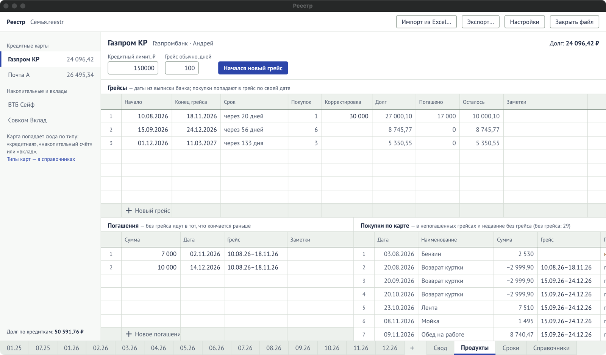
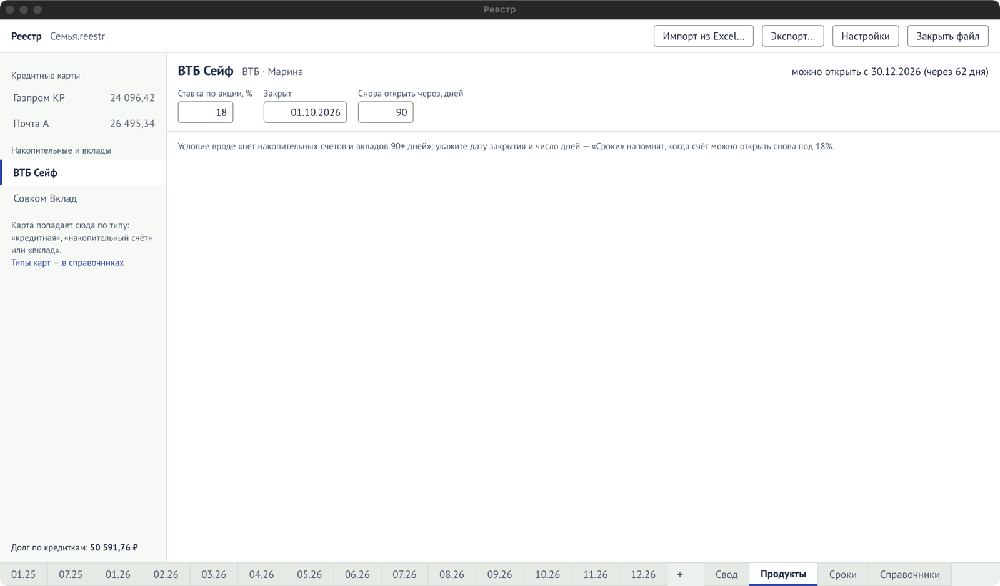
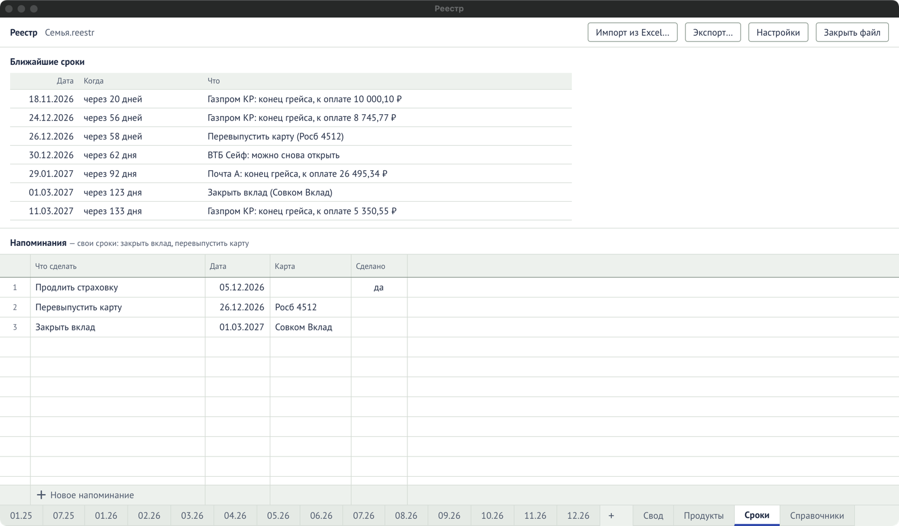

Лист **«Продукты»** (вкладка внизу) ведёт банковские продукты: кредитные карты с грейс-периодами
и накопительные счета и вклады. Лист **«Сроки»** собирает все ближайшие даты.

## Какие карты попадают в «Продукты»

Карта появляется здесь по своему **типу** в [«Справочники» → «Карты и
счета»](/reference/dictionaries/#карты-и-счета):

- «кредитная» — в разделе «Кредитные карты»;
- «накопительный счёт» или «вклад» — в разделе «Накопительные и вклады».

## Кредитная карта

Выберите карту слева. Вверху — банк, владелец и общий **долг** по карте.

1. Укажите **«Кредитный лимит, ₽»** (необязательно) и **«Грейс обычно, дней»** — сколько дней
   обычно длится беспроцентный период у этой карты.
2. Когда банк открыл новый беспроцентный период, нажмите **«Начался новый грейс»**. Программа
   добавит строку с сегодняшней датой начала и концом через обычное число дней. Поправьте даты
   по выписке банка: банки считают грейс по-разному, поэтому даты всегда вводите вы.
3. **Покупки сами попадают в нужный грейс по дате**: в тот, что начался последним не позже даты
   покупки. Покупки вносятся как обычно, в журнал месяца, с этой картой в колонке «Карта».
4. **Погашение** внесите в таблицу «Погашения» суммой и датой. Если грейс не указан, погашение
   уйдёт в тот, что кончается раньше и по которому ещё есть долг.

В таблице грейсов видно по каждому: сколько покупок, долг, погашено, **сколько осталось** и
когда срок. Просроченное — красным, срок в ближайшую неделю — оранжевым.

Если покупка попала не в тот грейс, в таблице «Покупки по карте» впишите нужный грейс в её
строку вручную. Очистите ячейку — покупка снова будет привязана по дате.

### Сверить остаток с банком

Посмотрите в приложении банка, сколько доступно по карте, и впишите это в **«Доступный остаток,
₽»**. В поле **«на дату»** подставится сегодняшний день; если сумма за другой день, исправьте.
Под полями появится строка сверки: расчётный остаток на эту дату и насколько он расходится с
банком. Покупки и погашения позже этой даты не считаются.

Если суммы разошлись, проверьте, все ли покупки и погашения внесены и верны ли их даты. Покупка
без грейса в долг не входит, как и в «Долге» вверху. Лишнее погашение одного грейса не уменьшает
долг других. Для сверки нужен «Кредитный лимит, ₽». Чтобы убрать остаток, очистите поле с суммой.

Все поля и колонки — в справочнике [«Продукты»](/reference/products/).

## Накопительный счёт или вклад

У многих банков повышенная ставка действует, только если у вас не было накопительных счетов и
вкладов, например, 90 дней. Чтобы не считать дни вручную:

1. Выберите счёт слева.
2. Укажите **«Ставка по акции, %»**, дату, когда счёт **«Закрыт»**, и **«Снова открыть через,
   дней»**.
3. Программа скажет, с какого числа счёт можно открыть снова, и напомнит об этом в «Сроках».

## «Сроки»

Лист **«Сроки»** собирает в одну таблицу:

- концы грейсов, по которым ещё есть долг, с суммой к оплате;
- даты, когда можно снова открыть накопительный счёт;
- ваши **напоминания** — «закрыть вклад», «перевыпустить карту».

Напоминание добавляется в строке **«Новое напоминание»**: что сделать, дата, при желании карта.
Когда сделали — поставьте «да» в колонке «Сделано», и напоминание уйдёт из ближайших сроков.

Просроченное — красным, ближайшая неделя — оранжевым. На вкладке «Сроки» появляется число
срочных дел. При открытии файла программа один раз показывает срочное над листом; кнопка
**«Все сроки»** ведёт на этот лист.
