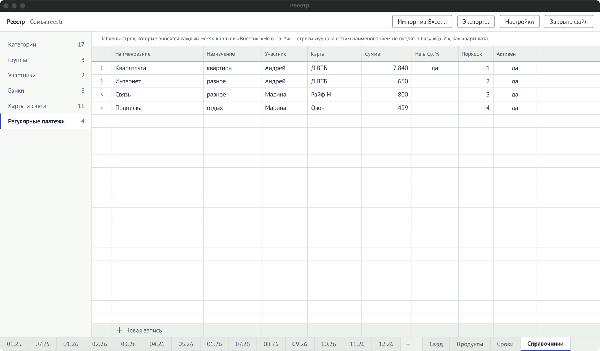

Регулярные платежи — это шаблоны строк, которые повторяются каждый месяц: квартплата,
интернет, связь, подписки.

## Внести регулярный платёж

На листе месяца в блоке **«Регулярные платежи»**:

- **«Внести»** у платежа — добавляет его строкой в журнал этого месяца с назначением,
  участником, картой и суммой из шаблона и отметкой «регулярная». Дату впишите в журнале, сумму
  при необходимости поправьте там же;
- **«Внести недостающие»** — вносит все, которых в этом месяце ещё нет;
- отметка **«внесён»** — строка с таким наименованием в месяце уже есть.

## Завести или поменять шаблон

Шаблоны правятся в **«Справочники» → «Регулярные платежи»**: наименование, назначение,
участник, карта, сумма, порядок, «Активен». Снимите «Активен», чтобы платёж больше не
предлагался, не теряя историю.

## «Не в Ср. %»

Отметка **«Не в Ср. %»** у шаблона значит: строки журнала с этим наименованием не входят в
базу среднего процента кэшбэка месяца. Так было в Excel с квартплатой: за неё кэшбэка нет, и
она не должна занижать средний процент. В новом файле у квартплаты эта отметка уже стоит.

## Регулярная трата и колонка «Регулярная»

Колонка «Регулярная» в журнале отмечает регулярные траты: их сумма видна в итогах месяца
(«Регулярные») и в «Своде». Строки, внесённые из шаблона, отмечаются сами. У категории в
справочнике можно задать, чтобы новые строки этой категории сразу отмечались регулярными.
