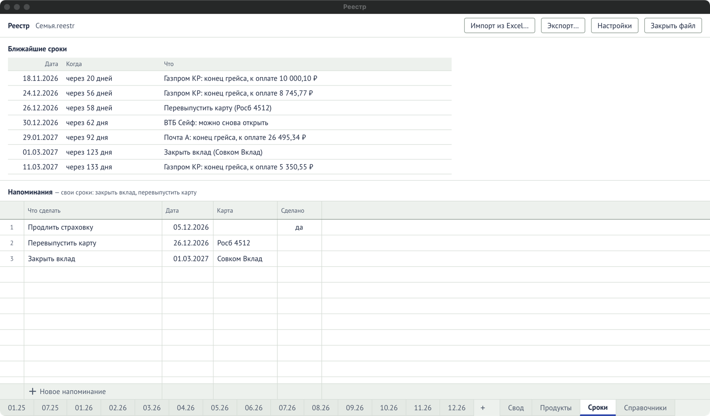

Лист «Сроки» — вкладка внизу. Число на вкладке — сколько дел просрочено или наступает в
ближайшие 7 дней.

## Ближайшие сроки

| Колонка | Что значит                                                   |
| ------- | ------------------------------------------------------------ |
| Дата    | Когда.                                                       |
| Когда   | «сегодня», «завтра», «через N дней», «просрочено на N дней». |
| Что     | Что сделать.                                                 |

Что сюда попадает:

- «Карта: конец грейса, к оплате X ₽» — конец грейса, по которому остался долг;
- «Счёт: можно снова открыть» — дата из полей накопительного счёта;
- ваши напоминания, которые ещё не сделаны (с картой в скобках, если она указана).

Красным — просроченное, оранжевым — ближайшая неделя.

## Напоминания

«Напоминания — свои сроки: закрыть вклад, перевыпустить карту».

| Колонка     | Что значит                                              |
| ----------- | ------------------------------------------------------- |
| Что сделать | Текст напоминания. Обязателен; с него начинается новое. |
| Дата        | Когда.                                                  |
| Карта       | К какой карте относится. Необязательно.                 |
| Сделано     | «да» — напоминание уходит из ближайших сроков.          |
