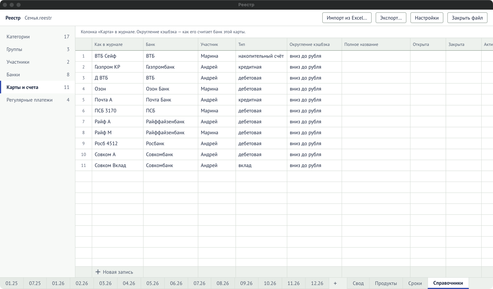
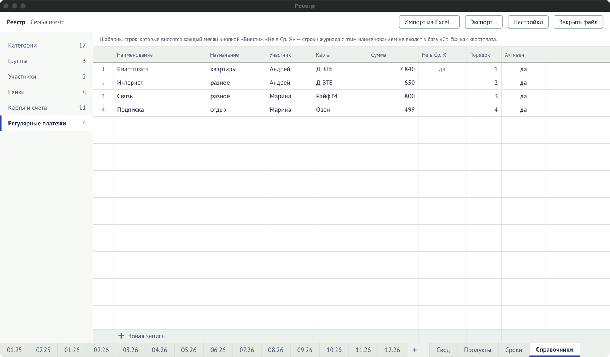

Лист «Справочники» — вкладка внизу. Слева — список справочников с числом записей. В каждом:
строка «Новая запись» внизу, удаление строк с подтверждением, `Ctrl+Z` отменяет любую правку.

## Общие правила

- **Название не может быть пустым** и не может повторяться в одном справочнике.
- **Запись, которая используется, удалить нельзя** — программа скажет, в скольких строках она
  встречается. Вместо удаления снимите отметку **«Активна»**: запись пропадёт из списков и
  подсказок, но история останется.
- **«Порядок»** — целое число; по нему сортируются списки и колонки итогов.
- В колонках со ссылкой на другой справочник (группа, банк, участник, категория, карта) можно
  ввести новое название — оно добавится в тот справочник.

## Категории

«Назначение» в журнале. Порядок — порядок колонок в итогах.

| Поле       | Что значит                                                   |
| ---------- | ------------------------------------------------------------ |
| Название   | Как назначение пишется в журнале.                            |
| Группа     | В какую группу входит, для итогов по группам. Необязательно. |
| Регулярная | Новые строки этой категории сразу отмечаются регулярными.    |
| Порядок    | Место колонки в итогах месяца и «Своде».                     |
| Активна    | Показывать ли в списках.                                     |

## Группы

Объединяют категории в итогах: «Лечение/лекарства» = лечение + лекарства.

| Поле             | Что значит                                                              |
| ---------------- | ----------------------------------------------------------------------- |
| Название         | Название группы.                                                        |
| Категории группы | Какие категории входят. Только для чтения: группа задаётся у категории. |
| Порядок          | Место колонки в итогах по группам.                                      |

## Участники

Кто платил: колонка «Участник» в журнале.

| Поле    | Что значит                      |
| ------- | ------------------------------- |
| Имя     | Как участник пишется в журнале. |
| Порядок | Место в списках.                |
| Активен | Показывать ли в списках.        |

## Банки

| Поле     | Что значит                     |
| -------- | ------------------------------ |
| Название | Полное название банка.         |
| Коротко  | Короткое название для списков. |

## Карты и счета

Колонка «Карта» в журнале. Сюда же — накопительные счета, вклады и наличные.

| Поле               | Что значит                                                                                                                                              |
| ------------------ | ------------------------------------------------------------------------------------------------------------------------------------------------------- |
| Как в журнале      | Короткое название карты в колонке «Карта».                                                                                                              |
| Банк               | Банк карты.                                                                                                                                             |
| Участник           | Владелец.                                                                                                                                               |
| Тип                | «дебетовая», «кредитная», «накопительный счёт», «вклад» или «наличные». Достаточно первых букв: «кр». От типа зависит, появится ли карта в «Продуктах». |
| Округление кэшбэка | Как банк округляет кэшбэк: «вниз до рубля» (по умолчанию), «вниз до копейки», «до рубля», «до копейки».                                                 |
| Полное название    | Как карта называется у банка. Для памяти.                                                                                                               |
| Открыта, Закрыта   | Даты открытия и закрытия.                                                                                                                               |
| Активна            | Показывать ли в списках. Закрытым картам её стоит снять.                                                                                                |
| Заметки            | Любой текст.                                                                                                                                            |

## Регулярные платежи

Шаблоны строк, которые вносятся каждый месяц кнопкой «Внести» в блоке «Регулярные платежи».

| Поле         | Что значит                                                            |
| ------------ | --------------------------------------------------------------------- |
| Наименование | Наименование строки журнала.                                          |
| Назначение   | Категория.                                                            |
| Участник     | Кто платит.                                                           |
| Карта        | Чем платят.                                                           |
| Сумма        | Обычная сумма. Пусто — сумма вводится в журнале.                      |
| Не в Ср. %   | Строки с этим наименованием не входят в базу «Ср. %», как квартплата. |
| Порядок      | Место в блоке.                                                        |
| Активен      | Предлагать ли платёж.                                                 |
