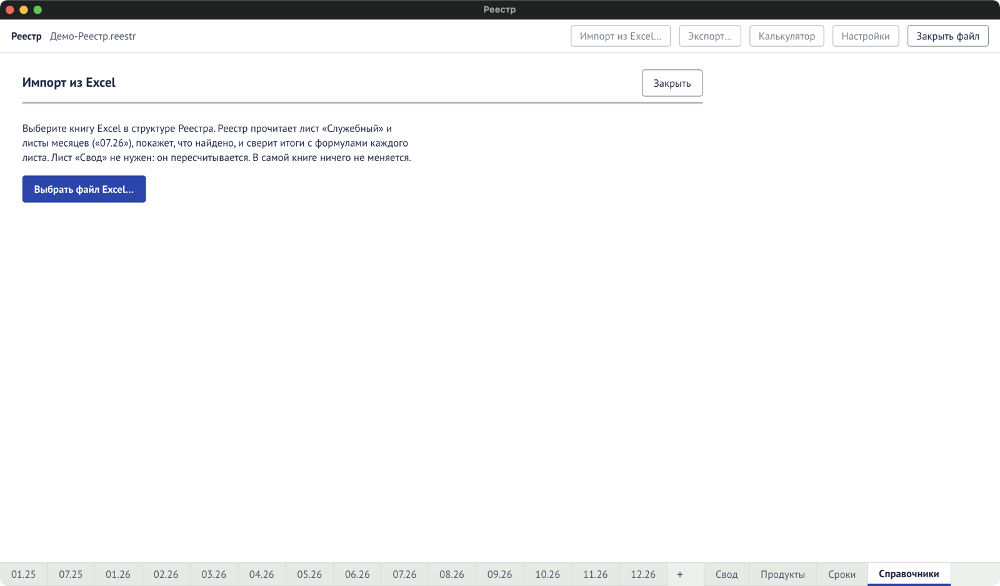

Открывается кнопкой **«Импорт из Excel…»** в шапке. Как пользоваться — в разделе [«Перенос из
Excel»](/start/import-excel/). Закрыть мастер — «Закрыть».

## Шаг 1. Выбор книги

Кнопка **«Выбрать файл Excel…»**. Программа читает лист «Служебный» и листы месяцев (`07.26`).
Книга не меняется.

Журнал читается из колонок A–J, а MCC — из колонки K. Если K пуста, строки переносятся без MCC.
Если в K стоит не код из 4 цифр, строка считается без MCC,
замечания программа не показывает. Число без ведущего нуля (`742`) тоже кодом не считается: в
выгрузке коды записаны текстом, поэтому нули сохраняются.

## Шаг 2. Что найдено

### Месяцы

| Колонка                  | Что значит                                                                           |
| ------------------------ | ------------------------------------------------------------------------------------ |
| Лист                     | Название листа месяца.                                                               |
| Строк                    | Сколько строк трат в листе.                                                          |
| Уже в файле              | Сколько из них уже есть в Реестре; их программа пропустит.                           |
| Сверка с формулами листа | «итоги совпадают до копейки» или расхождения вида «Еда: в листе 1 200, у нас 1 150». |

Пустые листы подсчитываются отдельно — из них ничего не импортируется.

### Карты

Названия карт из колонки «Карта» книги. Их можно уточнить сразу или позже в «Справочниках».

| Колонка       | Что значит                                         |
| ------------- | -------------------------------------------------- |
| Как в таблице | Название карты в книге.                            |
| Строк         | Сколько строк с этой картой.                       |
| Банк          | Банк; можно выбрать из подсказок или ввести новый. |
| Тип           | «не указан» или один из типов карт.                |
| Участник      | Владелец карты.                                    |

Карты, которые уже есть в справочнике, помечены «уже в справочнике».

### Добавится в справочники

Новые категории, группы, участники и карты — или «ничего нового».

### Замечания

До 50 строк вида «Лист 07.26, строка 14: …» — что программа не смогла прочитать.

### Кнопки

- **«Импортировать N строк»** — перенести. Если всё уже перенесено — «Всё уже импортировано».
- **«Отмена»** — ничего не менять.

## Шаг 3. Готово

«Добавлено N строк, пропущено N — они уже были в файле. Ctrl+Z отменит весь импорт.» Кнопка
**«К журналу»** открывает последний импортированный месяц.
