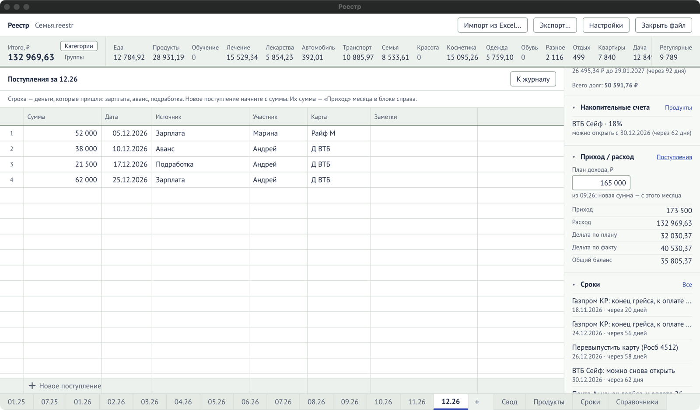

Открывается на листе месяца: блок «Приход / расход» → **«Поступления»**. Строка — деньги,
которые пришли: зарплата, аванс, подработка. Их сумма — «Приход» месяца.

| Колонка  | Что значит                                                                |
| -------- | ------------------------------------------------------------------------- |
| Сумма    | Сколько пришло, ₽. Больше нуля. С неё начинается новое поступление.       |
| Дата     | Когда пришло. Вводится так же, как [в журнале](/reference/columns/#дата). |
| Источник | Откуда: «Зарплата», «Аванс», «Подработка» — любой текст.                  |
| Участник | Кто получил.                                                              |
| Карта    | Куда пришло.                                                              |
| Заметки  | Любой текст.                                                              |

Новое поступление — строка «Новое поступление» внизу. Вернуться — «К журналу».

План дохода вводится не здесь, а в блоке [«Приход / расход»](/reference/side-blocks/#приход--расход).
