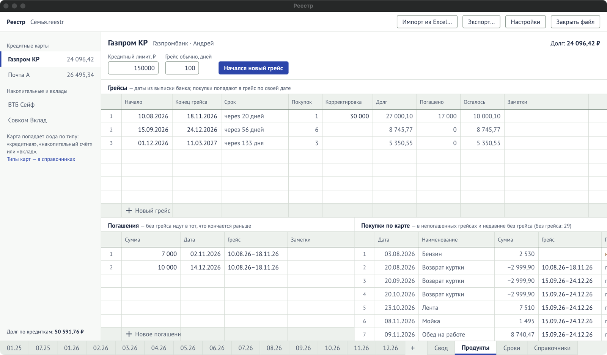
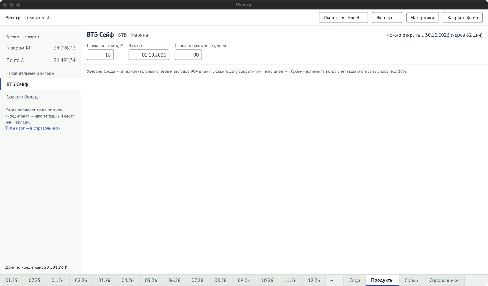

Лист «Продукты» — вкладка внизу. Как пользоваться — в разделе [«Кредитки, вклады и
сроки»](/guide/products-deadlines/).

## Левая колонка

| Элемент                    | Что значит                                                                              |
| -------------------------- | --------------------------------------------------------------------------------------- |
| Кредитные карты            | Карты с типом «кредитная», с долгом по каждой.                                          |
| Накопительные и вклады     | Карты с типом «накопительный счёт» или «вклад». «можно» — счёт уже можно открыть снова. |
| Типы карт — в справочниках | Ссылка на «Справочники» → «Карты и счета», где задаётся тип.                            |
| Долг по кредиткам          | Общий долг по всем кредитным картам.                                                    |

## Кредитная карта

Вверху — название, банк, владелец и **«Долг»**.

| Поле                  | Что значит                                                                                         |
| --------------------- | -------------------------------------------------------------------------------------------------- |
| Кредитный лимит, ₽    | Лимит карты по договору. Необязательно, не меньше нуля.                                            |
| Грейс обычно, дней    | Сколько дней обычно длится беспроцентный период. Из него считается конец нового грейса.            |
| «Начался новый грейс» | Добавить грейс: начало — сегодня, конец — через обычное число дней. Даты потом сверьте с выпиской. |

### Грейсы

«Грейсы — даты из выписки банка; покупки попадают в грейс по своей дате».

| Колонка       | Что значит                                                                       | Вводится  |
| ------------- | -------------------------------------------------------------------------------- | --------- |
| Начало        | Первый день периода по выписке.                                                  | да        |
| Конец грейса  | До какого числа погасить без процентов.                                          | да        |
| Срок          | «через N дней» или «погашен». Красным — просрочено, оранжевым — неделя и меньше. | считается |
| Покупок       | Сколько покупок попало в этот грейс.                                             | считается |
| Корректировка | Сумма, которой нет в журнале (например, комиссия банка).                         | да        |
| Долг          | Покупки + корректировка.                                                         | считается |
| Погашено      | Сумма погашений в этот грейс.                                                    | считается |
| Осталось      | Долг − погашено. Красным, если срок прошёл.                                      | считается |
| Заметки       | Любой текст.                                                                     | да        |

Покупка попадает в грейс, который начался последним не позже даты покупки. Покупка без даты ни
в какой грейс не попадает.

### Погашения

«Погашения — без грейса идут в тот, что кончается раньше».

| Колонка | Что значит                                                                                                             |
| ------- | ---------------------------------------------------------------------------------------------------------------------- |
| Сумма   | Сколько внесли. Больше нуля. С неё начинается новое погашение.                                                         |
| Дата    | Когда внесли.                                                                                                          |
| Грейс   | В какой грейс. Вводится так, как он подписан: `01.06.26–28.09.26`. Пусто — в грейс с долгом, который кончается раньше. |
| Заметки | Любой текст.                                                                                                           |

### Покупки по карте

Покупки из журнала в непогашенных грейсах и недавние без грейса. Здесь их не правят и не
удаляют — это делается в журнале месяца. Меняется только колонка **«Грейс»**:

| Колонка                   | Что значит                                                                         |
| ------------------------- | ---------------------------------------------------------------------------------- |
| Дата, Наименование, Сумма | Из журнала.                                                                        |
| Грейс                     | В каком грейсе покупка. Можно вписать другой; очистить — вернуть привязку по дате. |
| Привязка                  | «по дате», «вручную» или «нет грейса».                                             |

## Накопительный счёт или вклад

| Поле                      | Что значит                                                                                  |
| ------------------------- | ------------------------------------------------------------------------------------------- |
| Ставка по акции, %        | Повышенная ставка, ради которой счёт открывают. Показывается в блоке «Накопительные счета». |
| Закрыт                    | Дата закрытия счёта, `ДД.ММ.ГГГГ`.                                                          |
| Снова открыть через, дней | Сколько дней банк требует ждать до нового открытия на условиях акции.                       |

Состояние под названием: «открыт», «можно открыть с ДД.ММ.ГГГГ (через N дней)» или «можно
открыть — с ДД.ММ.ГГГГ». Дата нового открытия попадает в «Сроки».
