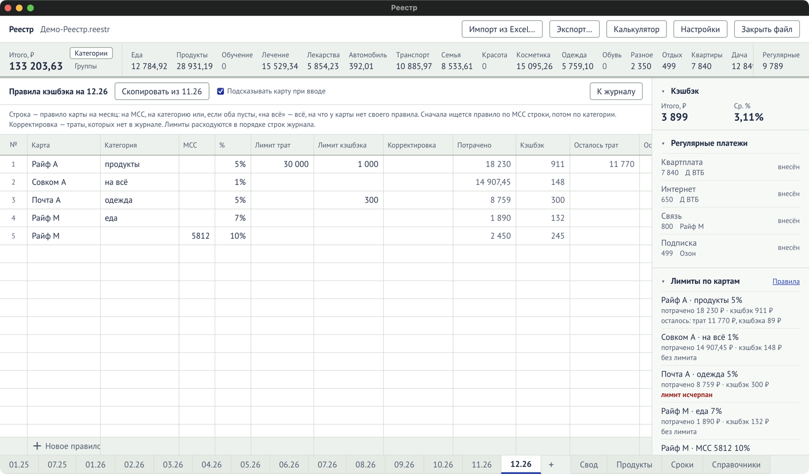

Открывается на листе месяца: блок «Лимиты по картам» → **«Правила»**. Как пользоваться — в
разделе [«Кэшбэк по правилам»](/guide/cashback-rules/).

Одна строка — правило одной карты на одну категорию или один MCC в этом месяце. Строка журнала
ищет правило в таком порядке: MCC, затем категория, затем «на всё».

| Колонка          | Что значит                                                                                                                                     | Вводится  |
| ---------------- | ---------------------------------------------------------------------------------------------------------------------------------------------- | --------- |
| Карта            | Карта, к которой относится правило. Обязательна.                                                                                               | да        |
| Категория        | Назначение, на которое действует процент. Пусто, «на всё» или «все» — на всё, на что у карты нет своего правила. У правила с MCC ячейка пуста. | да        |
| MCC              | Код продавца, 4 цифры. Правило действует на строки журнала с этим кодом. У правила либо MCC, либо категория.                                   | да        |
| %                | Процент кэшбэка.                                                                                                                               | да        |
| Лимит трат       | Сколько трат банк учитывает для кэшбэка. Пусто — без лимита.                                                                                   | да        |
| Лимит кэшбэка    | Больше скольких рублей кэшбэка банк не даст. Пусто — без лимита.                                                                               | да        |
| Корректировка    | Траты по этому правилу, которых нет в журнале. Расходуют лимит.                                                                                | да        |
| Потрачено        | Траты журнала по этому правилу.                                                                                                                | считается |
| Кэшбэк           | Начислено по правилу.                                                                                                                          | считается |
| Осталось трат    | Остаток лимита трат. Красным, когда 0.                                                                                                         | считается |
| Осталось кэшбэка | Остаток лимита кэшбэка. Красным, когда 0.                                                                                                      | считается |
| Заметки          | Любой текст: условия акции, срок.                                                                                                              | да        |

## Верх экрана

| Элемент                        | Что делает                                                                          |
| ------------------------------ | ----------------------------------------------------------------------------------- |
| «Скопировать из ММ.ГГ»         | Перенести правила прошлого месяца.                                                  |
| «Подсказывать карту при вводе» | Включает список «какой картой платить» в колонке «Карта» журнала. Хранится в файле. |
| «К журналу»                    | Вернуться к журналу месяца.                                                         |

## Правила ввода

- Новое правило начинается с карты, в строке «Новое правило».
- У карты в месяце — одно правило на категорию.
- Лимиты не бывают отрицательными.
- Удаление строк — с подтверждением, `Ctrl+Z` вернёт.
- Если изменение меняет кэшбэк уже введённых строк, программа спросит «Пересчитать» или
  «Оставить как есть».
