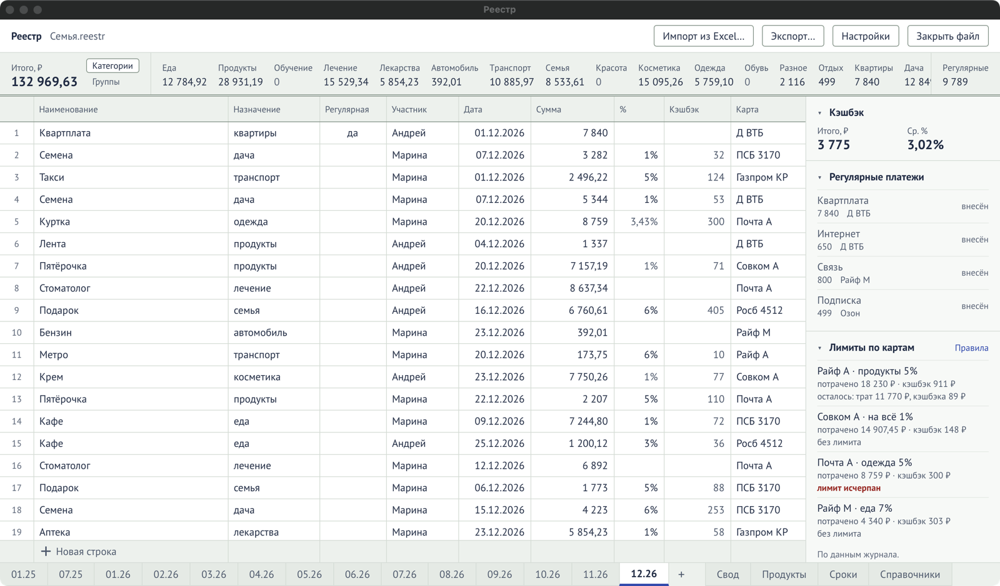

## Первый экран

Виден, пока файл не открыт.

| Элемент                  | Что делает                                                                       |
| ------------------------ | -------------------------------------------------------------------------------- |
| «Создать файл»           | Новый файл с данными. См. [«Первый файл и пароль»](/start/first-file/).          |
| «Открыть файл…»          | Открыть любой файл `.reestr`.                                                    |
| «Открыть «Семья.reestr»» | Открыть последний файл. Есть, только если файл уже открывали на этом компьютере. |

## Окно с открытым файлом

### Шапка

| Элемент            | Что делает                                                                                                                   |
| ------------------ | ---------------------------------------------------------------------------------------------------------------------------- |
| Название файла     | Подсказка при наведении — полный путь к файлу.                                                                               |
| «Импорт из Excel…» | Мастер переноса из книги Excel. См. [«Импорт из Excel»](/reference/import/).                                                 |
| «Экспорт…»         | Выгрузка в Excel или JSON. См. [«Экспорт»](/guide/export/).                                                                  |
| «Калькулятор»      | Что выгоднее: заплатить картой с кэшбэком или оставить деньги на накопительном. См. [«Калькулятор»](/reference/calculator/). |
| «Настройки»        | Вид, сведения о файле, копии, пароль. См. [«Настройки»](/reference/settings/).                                               |
| «Закрыть файл»     | Вернуться на первый экран.                                                                                                   |

### Надписи над листом

Появляются, только когда есть о чём сказать:

- **«Сроки: …»** — при открытии файла, если что-то просрочено или срок в ближайшую неделю. До
  трёх ближайших дел; кнопки «Все сроки» и «Скрыть».

### Вкладки внизу

| Вкладка           | Что на ней                                                                                                     |
| ----------------- | -------------------------------------------------------------------------------------------------------------- |
| `07.26`, `08.26`… | [Листы месяцев](/guide/month-sheet/). Формат — месяц.год.                                                      |
| `+`               | Добавить следующий месяц после последнего.                                                                     |
| «Свод»            | Год по месяцам. См. [«Свод»](/reference/summary/).                                                             |
| «Продукты»        | Кредитки и накопительные счета. См. [«Продукты»](/reference/products/).                                        |
| «Сроки»           | Ближайшие даты и напоминания. Число на вкладке — сколько срочных. См. [«Сроки»](/reference/deadlines/).        |
| «Справочники»     | Категории, группы, участники, банки, карты, регулярные платежи. См. [«Справочники»](/reference/dictionaries/). |

### Строка состояния

Самая нижняя строка окна. Здесь программа пишет, что произошло: «Отменено: правка», «Удалено: 2
строки. Ctrl+Z вернёт.», «В справочник добавлено: категория «кино»», ошибки ввода. Строка
очищается при переходе на другую вкладку.

## Лист месяца

| Часть         | Где    | Подробно                                                             |
| ------------- | ------ | -------------------------------------------------------------------- |
| Полоса итогов | сверху | [Блоки справа и итоги](/reference/side-blocks/#полоса-итогов-месяца) |
| Журнал        | слева  | [Колонки журнала](/reference/columns/)                               |
| Блоки         | справа | [Блоки справа и итоги](/reference/side-blocks/)                      |

На месте журнала могут открываться ещё две таблицы этого месяца:

- **«Правила кэшбэка на ММ.ГГ»** — из блока «Лимиты по картам» → «Правила». См.
  [«Правила кэшбэка»](/reference/rules/).
- **«Поступления за ММ.ГГ»** — из блока «Приход / расход» → «Поступления». См.
  [«Поступления»](/reference/inflows/).

Обе закрываются кнопкой «К журналу».

## Где что редактируется

| Что поменять                                   | Где                                             |
| ---------------------------------------------- | ----------------------------------------------- |
| Трату                                          | Лист месяца, журнал                             |
| Кэшбэк-проценты и лимиты карт на месяц         | Лист месяца → «Лимиты по картам» → «Правила»    |
| План дохода                                    | Лист месяца → блок «Приход / расход»            |
| Поступления денег                              | Лист месяца → «Приход / расход» → «Поступления» |
| Название или порядок категорий, группы         | «Справочники» → «Категории», «Группы»           |
| Банк, тип, владельца карты, округление кэшбэка | «Справочники» → «Карты и счета»                 |
| Шаблоны регулярных платежей                    | «Справочники» → «Регулярные платежи»            |
| Грейсы и погашения кредитки                    | «Продукты» → карта                              |
| Дату закрытия накопительного счёта             | «Продукты» → счёт                               |
| Свои напоминания                               | «Сроки» → «Напоминания»                         |
| Размер шрифта, блоки справа                    | «Настройки» → «Вид на этом компьютере»          |
| Пароль                                         | «Настройки» → «Пароль»                          |
