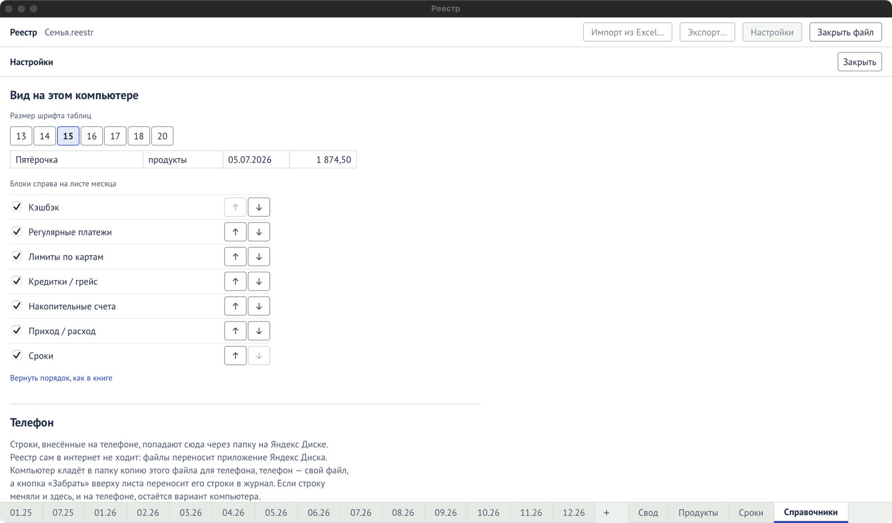

Открываются кнопкой **«Настройки»** в шапке; «Закрыть» возвращает к листам.

## Вид на этом компьютере

Хранится на этом компьютере, а не в файле: на другом компьютере вид может быть другим.

| Настройка                      | Что делает                                                              |
| ------------------------------ | ----------------------------------------------------------------------- |
| Размер шрифта таблиц           | 13–20 (по умолчанию 15). Пример строки показывает, как будет выглядеть. |
| Блоки справа на листе месяца   | Галочка — показывать блок; ↑ / ↓ — переставить.                         |
| «Вернуть порядок, как в книге» | Вернуть блоки как было; размер шрифта не меняется.                      |

## Телефон

Обмен строками с телефоном через Яндекс Диск. Как настроить — в разделе
[«Телефон»](/guide/phone/).

| Элемент                          | Что значит                                                                                  |
| -------------------------------- | ------------------------------------------------------------------------------------------- |
| «Выбрать папку на Яндекс Диске…» | Указать папку обмена. Есть, пока папка не выбрана.                                          |
| Папка обмена                     | Где лежат файлы обмена.                                                                     |
| Копия для телефона               | Файл «… — для телефона.reestr». Пишется при открытии файла, после «Забрать» и при закрытии. |
| Файл с телефона                  | Файл «… — с телефона.reestr»: «телефон его ещё не записал» или «всё забрано».               |
| «Записать копию сейчас»          | Обновить копию для телефона немедленно.                                                     |
| «Выбрать другую папку…»          | Сменить папку обмена.                                                                       |
| «Не обмениваться с телефоном»    | Отключить обмен на этом компьютере.                                                         |

## О файле

| Строка          | Что значит                                                                 |
| --------------- | -------------------------------------------------------------------------- |
| Файл, Где лежит | Имя и папка файла.                                                         |
| Размер          | Размер файла.                                                              |
| Создан          | Дата создания и версия Реестра, которая его создала.                       |
| Версия данных   | Версия устройства файла; растёт при обновлениях программы.                 |
| Шифрование      | Как защищён файл: весь файл зашифрован AES-256, ключ получается из пароля. |

## Копии

Ежедневные копии файла: дата, имя, размер, сверху самые новые. Хранятся 10 последних. Как
вернуться к копии — в разделе [«Сохранность и копии»](/guide/backups/).

## Пароль

| Поле                               | Что значит                                                    |
| ---------------------------------- | ------------------------------------------------------------- |
| Текущий пароль                     | Нынешний пароль файла.                                        |
| Новый пароль, Новый пароль ещё раз | Не короче 8 символов, оба одинаковые.                         |
| Показать пароли                    | Показать введённое.                                           |
| Новый пароль записан на бумаге     | Обязательная отметка.                                         |
| «Сменить пароль»                   | Сменить. Копии, сделанные раньше, открываются старым паролем. |

Подробнее — [«Пароль»](/guide/password/).
