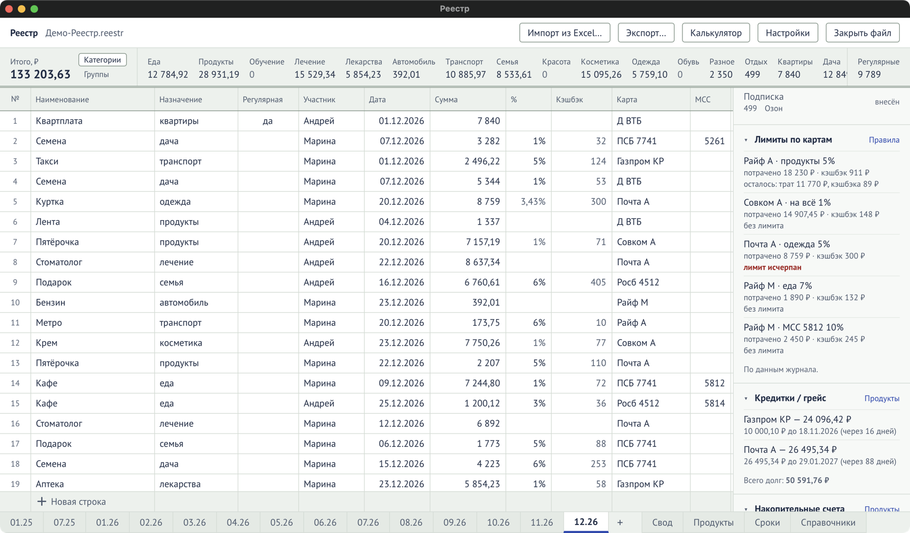
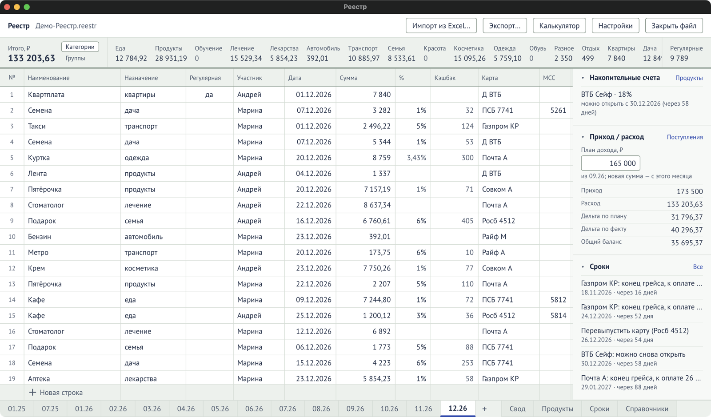

## Полоса итогов месяца

Над журналом.

| Элемент                      | Что значит                                                                                        |
| ---------------------------- | ------------------------------------------------------------------------------------------------- |
| Итого, ₽                     | Сумма всех трат месяца.                                                                           |
| «Категории» / «Группы»       | Показывать итоги по каждой категории или по группам. Выбор запоминается и действует и в «Своде».  |
| Колонка на каждое назначение | Сумма трат с этим назначением. Порядок колонок — колонка «Порядок» в справочнике. Нули — бледным. |
| Без назначения               | Траты, у которых назначение не указано. Появляется, только если такие есть.                       |
| Регулярные                   | Сумма строк с отметкой «Регулярная».                                                              |

## Блоки справа

Блок сворачивается и разворачивается щелчком по названию (▸ / ▾); это запоминается. Какие
блоки видны и в каком порядке — в «Настройки» → [«Вид на этом
компьютере»](/reference/settings/#вид-на-этом-компьютере). Порядок по умолчанию — как в этом разделе
ниже.

### Кэшбэк

| Строка   | Что значит                                                                                                                             |
| -------- | -------------------------------------------------------------------------------------------------------------------------------------- |
| Итого, ₽ | Кэшбэк всех строк месяца.                                                                                                              |
| Ср. %    | Средний процент кэшбэка: кэшбэк ÷ траты. Платежи с отметкой «Не в Ср. %» (квартплата) в траты не входят. «—», если считать не из чего. |

### Регулярные платежи

Активные шаблоны из справочника «Регулярные платежи» с суммой и картой.

| Элемент              | Что делает                                           |
| -------------------- | ---------------------------------------------------- |
| «Внести»             | Добавить платёж строкой в журнал этого месяца.       |
| «внесён»             | Строка с таким наименованием в месяце уже есть.      |
| «Внести недостающие» | Внести все, которых ещё нет. Видна, если такие есть. |

Если шаблонов нет — ссылка «Добавить в справочниках». См. [«Регулярные
платежи»](/guide/regular-payments/).

### Лимиты по картам

Правила кэшбэка этого месяца и сколько от лимитов осталось.

| Элемент                         | Что значит                                                                                           |
| ------------------------------- | ---------------------------------------------------------------------------------------------------- |
| «Правила»                       | Открыть таблицу правил месяца.                                                                       |
| Карта А · Продукты 5%           | Карта, категория («на всё» — на остальное) и процент. У правила по MCC вместо категории: «MCC 5812». |
| потрачено X ₽ · кэшбэк Y ₽      | Сколько по правилу потрачено и начислено.                                                            |
| осталось: трат X ₽, кэшбэка Y ₽ | Остаток лимитов. «без лимита» — лимитов нет.                                                         |
| лимит исчерпан                  | Дальше по этому правилу кэшбэка не будет.                                                            |

Если правил на месяц нет — кнопка «Скопировать из ММ.ГГ».

### Кредитки / грейс

| Элемент                          | Что значит                                               |
| -------------------------------- | -------------------------------------------------------- |
| «Продукты»                       | Перейти на лист «Продукты».                              |
| Карта — X ₽                      | Долг по кредитке.                                        |
| X ₽ до ДД.ММ.ГГГГ (через N дней) | Сколько и до какого числа погасить по ближайшему грейсу. |
| Всего долг                       | Долг по всем кредиткам.                                  |

### Накопительные счета

Закрытые счета, которые ждут, когда их можно будет открыть снова: ставка и «можно открыть с …».
Ссылка «Продукты» ведёт на лист продуктов.

### Приход / расход

| Элемент         | Что значит                                                                          |
| --------------- | ----------------------------------------------------------------------------------- |
| «Поступления»   | Открыть таблицу поступлений месяца.                                                 |
| План дохода, ₽  | Вводится здесь. `Enter` сохраняет, `Esc` отменяет. Переносится на следующие месяцы. |
| Приход          | Сумма поступлений.                                                                  |
| Расход          | Сумма трат.                                                                         |
| Дельта по плану | План дохода − расход.                                                               |
| Дельта по факту | Приход − расход.                                                                    |
| Общий баланс    | План дохода + кэшбэк − расход, как в «Своде».                                       |

Отрицательные числа — красным.

### Сроки

До пяти ближайших сроков с датой и «через N дней». Ссылка «Все» ведёт на лист «Сроки».
