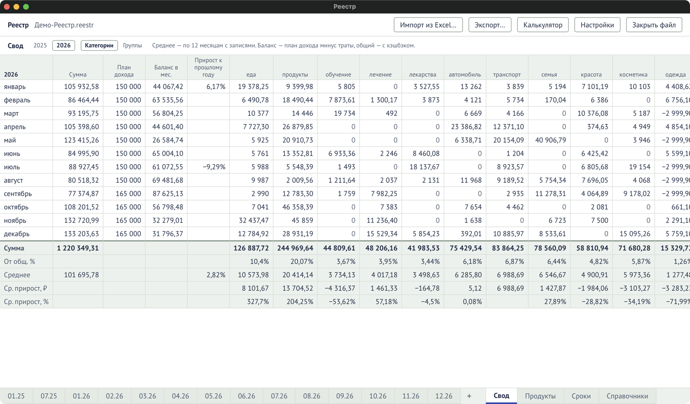

Лист «Свод» — вкладка внизу. Только для чтения: всё считается из журнала, плана дохода и
поступлений.

## Верх листа

| Элемент                         | Что значит                                                                           |
| ------------------------------- | ------------------------------------------------------------------------------------ |
| Вкладки лет                     | Годы, в которых есть записи.                                                         |
| Колонки: «Категории» / «Группы» | Траты по каждой категории или по группам. Общий выбор с полосой итогов листа месяца. |

## Колонки

Строки — месяцы года. Месяц без записей показан бледным, только с планом.

| Колонка                      | Что значит                                                                       |
| ---------------------------- | -------------------------------------------------------------------------------- |
| Сумма                        | Траты месяца.                                                                    |
| План дохода                  | План дохода месяца.                                                              |
| Баланс в мес.                | План дохода − траты.                                                             |
| Прирост к прошлому году      | На сколько процентов траты больше или меньше, чем в том же месяце прошлого года. |
| Колонка на каждое назначение | Траты по категории или группе.                                                   |
| Регулярные                   | Регулярные траты.                                                                |
| Кешбек                       | Кэшбэк месяца.                                                                   |
| Общий баланс                 | План дохода + кэшбэк − траты.                                                    |
| Общий % кешбека              | Кэшбэк ÷ траты.                                                                  |

Отрицательный баланс — красным.

## Итоговые строки

| Строка                          | Что значит                                                                                                             |
| ------------------------------- | ---------------------------------------------------------------------------------------------------------------------- |
| Сумма                           | Сумма за год по каждой колонке.                                                                                        |
| От общ. %                       | Доля колонки в тратах года.                                                                                            |
| Среднее                         | Среднее по месяцам с записями (сколько их — написано вверху листа).                                                    |
| Ср. прирост, ₽ / Ср. прирост, % | Средние траты месяца этого года минус прошлого — в рублях и в процентах. Есть, только если в прошлом году были записи. |
