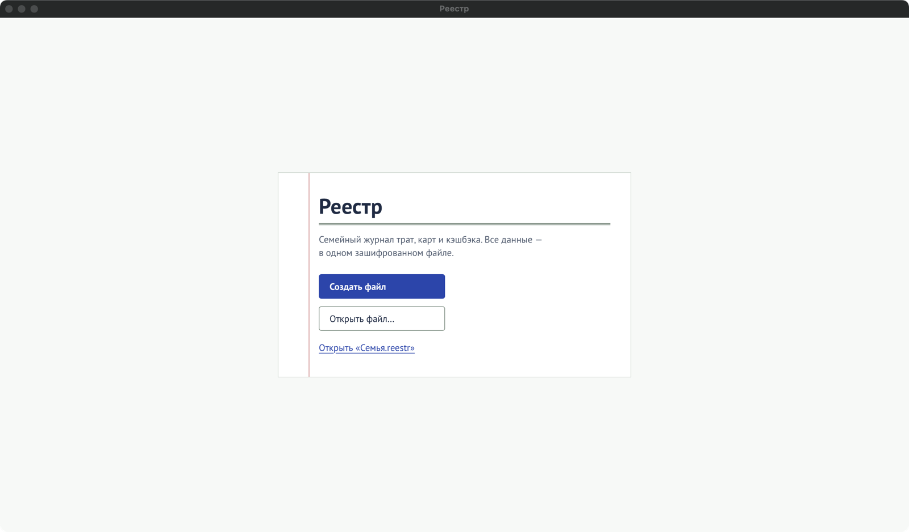

Все данные Реестра — траты, карты, правила, продукты — лежат в **одном файле** с расширением
`.reestr`. Файл зашифрован целиком; открыть его можно только паролем.

## Создать файл

1. Запустите Реестр. На первом экране нажмите **«Создать файл»**.
2. Выберите, где файл будет лежать и как называться, например `Документы\Семья.reestr`.
3. Придумайте пароль — **не короче 8 символов** — и введите его в поля «Пароль» и «Повторите
   пароль». Галочка «Показать пароль» показывает введённое.
4. Запишите пароль на бумаге и поставьте галочку **«Пароль записан на бумаге»** — без неё
   программа файл не создаст.
5. Нажмите **«Создать файл»**.

:::danger[Пароль нельзя восстановить]
Без пароля файл не откроет никто, в том числе сама программа и её автор. Запишите пароль на
бумаге и храните её отдельно от компьютера.
:::

Программа не перезаписывает существующие файлы: если файл с таким именем уже есть, она попросит
выбрать другое имя.

## Открыть файл в следующий раз

На первом экране будет кнопка **«Открыть «Семья.reestr»»** — это последний открытый файл.
Нажмите её и введите пароль.

Чтобы открыть другой файл, нажмите **«Открыть файл…»** и выберите его.

## Закрыть файл

Кнопка **«Закрыть файл»** в правом верхнем углу возвращает на первый экран. Сохранять ничего не
нужно: каждое изменение записывается в файл сразу.

## Если пароль не подходит

- Проверьте раскладку клавиатуры (русская или английская) и Caps Lock.
- Если пароль меняли, старые [копии файла](/guide/backups/) открываются старым паролем.

Другие сообщения при открытии файла — в разделе [«Сообщения программы»](/help/messages/).
