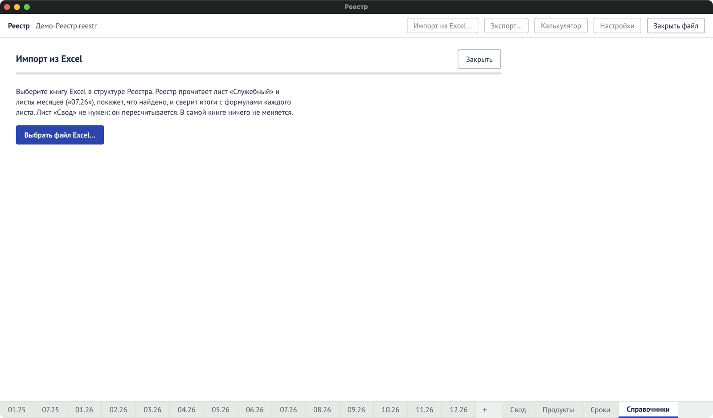

Книгу Excel в структуре Реестра можно перенести в файл целиком: месяцы, назначения, участников и
карты. Структура та же, что у [выгрузки в Excel](/guide/export/): лист «Служебный» с назначениями
и листы месяцев «ММ.ГГ» с журналом.

## Как перенести

1. Откройте файл Реестра и нажмите **«Импорт из Excel…»** вверху.
2. Нажмите **«Выбрать файл Excel…»** и выберите книгу.
3. Программа прочитает лист «Служебный» и листы месяцев («07.26», «08.26»…) и покажет, что
   нашла:
   - **месяцы** — сколько строк в каждом листе и совпадают ли итоги с формулами листа. Надпись
     «итоги совпадают до копейки» значит, что всё перенесено верно;
   - **карты** — для каждой можно сразу указать банк, тип (кредитная, дебетовая…) и участника.
     Это можно сделать и позже в [«Справочниках»](/reference/dictionaries/);
   - **что добавится в справочники** — новые категории, группы, участники и карты;
   - **замечания** — строки, которые программа не смогла прочитать, с номером листа и строки.
4. Нажмите **«Импортировать N строк»**.

Подробно о каждой таблице мастера — в справочнике: [«Импорт из Excel»](/reference/import/).

## Что важно знать

- Саму книгу Excel программа **не меняет**.
- Лист «Свод» не нужен — Реестр пересчитывает его сам.
- Импорт можно **повторить**: строки, которые уже есть в файле, не задвоятся. Если всё уже
  перенесено, кнопка покажет «Всё уже импортировано».
- Весь импорт отменяется одним `Ctrl+Z` сразу после него.
- Если книга не читается, откройте её в Excel и сохраните в формате `.xlsx`.

## Если что-то не так

| Сообщение                                 | Что делать                                                                                                 |
| ----------------------------------------- | ---------------------------------------------------------------------------------------------------------- |
| «Не удалось прочитать книгу Excel…»       | Откройте книгу в Excel и сохраните как `.xlsx`.                                                            |
| «В книге нет листа «Служебный»…»          | Похоже, у книги другая структура: нужны лист «Служебный» и листы месяцев.                                  |
| «В книге нет листов месяцев вида «07.26»» | Листы месяцев должны называться `ММ.ГГ`.                                                                   |
| «Книгу нужно выбрать заново»              | Программа уже не держит прочитанную книгу (например, её только что импортировали). Выберите книгу ещё раз. |
| «Еда: в листе 1 200, у нас 1 150»         | Итог в листе не совпал с суммой строк. Проверьте формулу в Excel: часто она не захватывает все строки.     |
